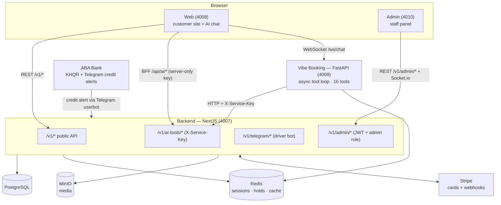

# DerLg

**Cambodia travel booking platform with an AI concierge.**

Travelers discover trips, hotels, guides, and transport; compose multi-item bookings; and pay by card (Stripe) or Cambodian ABA KHQR. An AI agent ("Vibe Booking") guides the whole journey over WebSocket, and staff run operations from a role-based admin panel.

> *"Make Cambodia travel booking as easy as texting a friend who knows every temple, tuk-tuk driver, and hidden beach."*

---

## Contents

- [Services at a glance](#services-at-a-glance)
- [Architecture](#architecture)
- [Quick start](#quick-start)
- [First run: database and seed](#first-run-database-and-seed)
- [Signing in](#signing-in)
- [Environment variables](#environment-variables)
- [Ports: configured vs dev](#ports-configured-vs-dev)
- [Testing](#testing)
- [Repository layout](#repository-layout)
- [Documentation map](#documentation-map)
- [Troubleshooting](#troubleshooting)

---

## Services at a glance

The platform is a **monorepo of four services**:

| Service | Tech | Dev port | Directory | Purpose |
|---------|------|----------|-----------|---------|
| **Backend** | NestJS 11 · Prisma 6 · Socket.io | `4007` | [`backend/`](backend/README.md) | Single API server: public `/v1/*`, AI `/v1/ai-tools/*`, admin `/v1/admin/*`, Telegram `/v1/telegram/*` |
| **Web** | Next.js 16 · React 19 · TanStack Query | `4008` | [`web/`](web/README.md) | Customer booking site with AI chat, EN / ZH / KM |
| **Vibe Booking** | FastAPI · Python 3.12 · Redis | `4009` | [`vibe-booking/`](vibe-booking/README.md) | Stateful AI booking concierge (WebSocket + 16-tool loop) |
| **Admin** | Next.js 16 · React 19 · shadcn | `4010` | [`derlg-system-admin/`](derlg-system-admin/README.md) | Staff panel (frontend-only; its API lives in the backend) |

Supporting infrastructure: **PostgreSQL**, **Redis**, and **MinIO** (object storage for media).

## Architecture



**Key protocols**

| Edge | Protocol | Where the contract lives |
|------|----------|--------------------------|
| Web → Backend | REST `/v1/*`, TanStack Query | `web/lib/api/client.ts` |
| Web → AI agent | WebSocket `/ws/chat` | `web/lib/vibe/protocol.ts`, `web/lib/vibe/socket.ts` |
| Web BFF → Backend | `/v1/ai-tools/*` with `X-Service-Key` (server-only) | `web/app/api/ai/*` |
| Admin → Backend | REST `/v1/admin/*` + Socket.io `/v1/admin/ws` | `derlg-system-admin/lib/api.ts` |
| AI → Backend | HTTP `/v1/ai-tools/*`, `X-Service-Key`, circuit breaker | `vibe-booking/agent/backend_client.py` |

## Quick start

Prerequisites: **Node.js 20+**, **Python 3.12**, **Docker** (or native Postgres/Redis), and MinIO for seeded imagery.

```bash
# From the repository root — starts all four services, streams logs,
# auto-restarts anything that dies. Ctrl+C stops everything.
./run-all.sh

# Or start just one:
./run-all.sh backend   # NestJS API      → http://localhost:4007/v1
./run-all.sh web       # customer site   → http://localhost:4008
./run-all.sh ai        # AI concierge    → http://localhost:4009
./run-all.sh admin     # staff panel     → http://localhost:4010
```

Logs stream to the terminal and are saved to `logs/<service>.log`.

`run-all.sh` sets the dev ports (4007–4010) and cross-service URLs via env overrides, so the individual `.env` files can keep their configured defaults. It also unsets stale `LLM_API_KEY` / `RAYU_API_KEY` / `NVIDIA_API_KEY` shell exports before launching the AI agent.

## First run: database and seed

**1. Infrastructure.** Two supported setups:

```bash
# Option A — Docker (fallback / CI): Postgres 16 on :5433, Redis on :6380
cd backend && docker compose up -d

# Option B — native services managed by systemd (primary dev setup):
#   Postgres on :5434 (check `pg_lsclusters`), Redis on :6380
#   See backend/.env.example for the exact connection strings.
```

MinIO (media storage, `:9000`) runs separately; `backend/prisma/seeds/setup-minio.js` prepares the bucket. Supabase is deliberately **not** used in any environment.

**2. Configure each service** (copy the annotated examples, then fill in secrets):

```bash
cp backend/.env.example            backend/.env
cp web/.env.local.example          web/.env.local
cp vibe-booking/.env.example       vibe-booking/.env
cp derlg-system-admin/.env.local.example derlg-system-admin/.env.local
```

**3. Migrate and seed:**

```bash
cd backend
npx prisma migrate deploy   # apply migrations — never `migrate dev`
npm run prisma:seed         # reference data, catalogue, admin accounts, fixtures
```

The seed is idempotent and dependency-ordered (languages → places → hotels → transport → guides → trips → festivals → discounts → admin users → drivers/vehicles → booking fixtures).

**4. Verify:**

```bash
curl http://localhost:4007/v1/health      # backend  → {"success":true,...}
curl http://localhost:4009/health         # AI agent
```

## Signing in

| Surface | URL | Account |
|---------|-----|---------|
| Admin panel | http://localhost:4010 | `admin@derlg.demo` (SUPER_ADMIN), `ops@derlg.demo`, `fleet@derlg.demo`, `support@derlg.demo` |
| Customer site | http://localhost:4008 | Register, or use seeded fixtures |

Admin password comes from `SEED_ADMIN_PASSWORD` in `backend/.env`. Leave it blank in development and the seed uses a documented dev fallback; it is **required** when `NODE_ENV=production`. Each admin role sees a different sidebar, mirroring the backend guards.

## Environment variables

Each service owns its `.env`, validated at boot (Zod in the backend, Pydantic in the agent). See the annotated examples linked above for the full lists. The values that must **match across services**:

| Secret | Must be identical in | Purpose |
|--------|----------------------|---------|
| `AI_SERVICE_KEY` | backend, web, vibe-booking | Service-to-service auth for `/v1/ai-tools/*` (32+ chars, high entropy, no placeholders) |
| `JWT_ACCESS_SECRET` (backend, web) = `JWT_SECRET` (vibe-booking) | backend, web, vibe-booking | Access-token signing/verification |
| `REDIS_URL` | backend, vibe-booking | Same instance: admin AI-session views read the `session:{id}` keys the agent writes |

Server-only secrets (`AI_SERVICE_KEY`, `JWT_ACCESS_SECRET`, `STRIPE_SECRET_KEY`, `TELEGRAM_SESSION`) must **never** carry a `NEXT_PUBLIC_` prefix or reach the browser.

## Ports: configured vs dev

The `.env` defaults and `run-all.sh` dev overrides differ on purpose (to avoid clashes with other stacks on the host):

| Service | Configured default | Dev (`run-all.sh`) |
|---------|--------------------|--------------------|
| Backend | 3003 | **4007** |
| Web | 3002 | **4008** |
| Vibe Booking | 8001 | **4009** |
| Admin | 5000 | **4010** |
| Postgres | 5434 native / 5433 Docker | same |
| Redis | 6380 (6379 is often taken) | same |
| MinIO | 9000 | same |

When starting services manually, pass the port explicitly (`PORT=4007 npm run start:dev`, `npx next dev -p 4008`, …) and allowlist the resulting origins in `CORS_ORIGINS` (backend) and `ALLOWED_WS_ORIGINS` (agent).

## Testing

| Service | Framework | Run |
|---------|-----------|-----|
| Backend | Jest (unit + e2e) | `npm test` · `npm run test:e2e` |
| Web | Vitest + Testing Library · Playwright | `npm run test` · `npm run e2e` · `npm run verify` |
| Vibe Booking | pytest + hypothesis | `pytest` · `pytest --cov=agent --cov-report=html` |
| Admin | Jest + Testing Library | `npm test` |

## Repository layout

```
DerLg/
├── backend/               # NestJS API — public, AI-tools, admin, Telegram
│   ├── prisma/            # Schema, hand-reviewed migrations, ordered seeds
│   ├── src/common/        # Global guards, interceptors, filters, cache, i18n
│   ├── src/modules/       # 16 feature modules
│   └── docs/              # payments.md, admin-merge notes
├── web/                   # Customer Next.js app (EN/ZH/KM, PWA)
│   ├── app/[locale]/      # Localised routes
│   ├── app/api/ai/        # BFF handlers — the only reader of AI_SERVICE_KEY
│   ├── lib/{api,vibe}/    # Typed REST + WebSocket clients
│   └── e2e/               # Playwright tests
├── vibe-booking/          # AI concierge (FastAPI)
│   ├── agent/             # Tool loop, prompts, session state, model clients
│   ├── api/               # WebSocket endpoint, health, middleware
│   └── tests/             # unit / integration / property
├── derlg-system-admin/    # Staff panel (frontend-only)
│   ├── app/admin/         # 16 feature areas (dashboard … vehicles)
│   └── docs/              # Architecture, specs, guides, PRD
├── data/                  # Seed imagery (PhnomPenh, SiemReap)
├── logs/                  # Service logs (gitignored)
├── run-all.sh             # Start/supervise all four services
└── AGENTS.md              # Agent context index (read first for AI-assisted work)
```

## Documentation map

**Start here per service**

| Document | Audience | Contents |
|----------|----------|----------|
| [backend/README.md](backend/README.md) | Everyone | Setup, modules, API conventions, scripts |
| [web/README.md](web/README.md) | Everyone | Setup, i18n, architecture, features |
| [vibe-booking/README.md](vibe-booking/README.md) | Everyone | Agent overview, quick start, features F10–F16 |
| [derlg-system-admin/README.md](derlg-system-admin/README.md) | Everyone | Panel overview, roles, feature areas |
| [derlg-system-admin/START.md](derlg-system-admin/START.md) | Operators | Manual start, health checks, common problems |

**Deep dives**

| Document | Contents |
|----------|----------|
| [backend/docs/payments.md](backend/docs/payments.md) | Stripe + ABA KHQR: setup, settlement model, refunds, test cards |
| [vibe-booking/AGENT.md](vibe-booking/AGENT.md) | Agent internals: tool loop, WS protocol, sessions, resilience |
| [derlg-system-admin/docs/architecture/](derlg-system-admin/docs/architecture/) | Admin architecture diagrams and system design |
| [derlg-system-admin/docs/guides/](derlg-system-admin/docs/guides/) | Admin panel user guide, Telegram bot guide |
| [derlg-system-admin/docs/reference/prd.md](derlg-system-admin/docs/reference/prd.md) | Product requirements |
| [backend/docs/admin-merge/](backend/docs/admin-merge/) | Admin-panel merge baseline and port inventory |

**For AI coding agents:** [AGENTS.md](AGENTS.md) (root) → [backend/AGENTS.md](backend/AGENTS.md) → [vibe-booking/AGENT.md](vibe-booking/AGENT.md) → [derlg-system-admin/AGENTS.md](derlg-system-admin/AGENTS.md).

## Troubleshooting

| Symptom | Cause and fix |
|---------|---------------|
| Chat WebSocket closes with code **4403** | Web origin missing from `ALLOWED_WS_ORIGINS` in `vibe-booking/.env` |
| Admin API calls hit `/v1/v1/...` and 404 | `NEXT_PUBLIC_API_URL` must have **no** `/v1` suffix; the client appends it |
| Backend exits with "Environment validation failed" | Zod names the offending key; add it to `backend/.env` per `.env.example` |
| Card payments return 503 | `STRIPE_SECRET_KEY` empty; set it (see [payments doc](backend/docs/payments.md)) |
| Admin pages 403 while signed in | No active `admin_users` grant; re-run `npm run prisma:seed` |
| AI agent uses the wrong LLM key | Stale shell export; `run-all.sh` unsets it, or launch with `env -u NVIDIA_API_KEY …` |
| Admin AI-session lookups 404 | Backend and agent point at different Redis instances; align `REDIS_URL` |
| Telegram endpoints report "disabled" | Expected: `TELEGRAM_BOT_ENABLED=false` by default |

More per-service gotchas live in each service's README and AGENTS file.