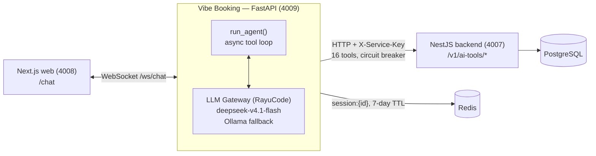

# Vibe Booking — AI Travel Concierge

> **Feature IDs:** F10–F16 · **Status:** Implemented · **Scope:** MVP
> Part of the [DerLg monorepo](../README.md). Dev port **4009** via `run-all.sh` (settings default 8000).

**Vibe Booking** is DerLg's core product differentiator: a conversational AI interface that lets travelers discover, plan, and book complete Cambodia trips through natural language chat.

> *"Make Cambodia travel booking as easy as texting a friend who knows every temple, tuk-tuk driver, and hidden beach."*

It is **not a general-purpose chatbot**. Every fact (price, availability, hotel name) comes from a backend tool call — the agent never invents data.

---

## Contents

- [Architecture](#architecture)
- [Quick start](#quick-start)
- [Environment variables](#environment-variables)
- [Features (F10–F16)](#features-f10f16)
- [Tool system](#tool-system)
- [Chat protocol and rendering](#chat-protocol-and-rendering)
- [Sessions and languages](#sessions-and-languages)
- [Resilience and security](#resilience-and-security)
- [Testing](#testing)
- [Further reading](#further-reading)

---

## Architecture



**Flow per turn:** user message → system prompt built from session state → LLM decides tool calls → tools executed in parallel against the backend → results fed back to the LLM (max 5 loops) → Markdown text + typed `content_payloads` streamed to the frontend → session saved to Redis.

**Key components**

| Component | Implementation |
|-----------|----------------|
| Agent core | Hand-rolled async tool loop (not LangGraph): `agent/core.py` — `run_agent()` / `run_agent_streaming()` |
| LLM | OpenAI-compatible Gateway (RayuCode `deepseek-v4.1-flash` → gateway id `deepseek-v4.1-flash-cloud`; [API keys](https://rayucode.com/docs/15-api-keys)); Ollama local fallback (`USE_OLLAMA=true`) |
| Tools | 16 JSON-schema tools + `TOOL_DISPATCH` map in `agent/tools/_defs.py`; parallel via `asyncio.gather` |
| Backend client | `agent/backend_client.py` — httpx, `X-Service-Key`, 15 s timeout, circuit breaker |
| Sessions | `agent/session/` — `ConversationState` (Pydantic) in Redis, 7-day TTL |
| API layer | `api/websocket.py` (`/ws/chat`), `api/health.py`, `api/middleware.py` |
| Frontend | `web/` `/chat` route: react-markdown + 19 payload block renderers |

## Quick start

```bash
cd vibe-booking
python3 -m venv .venv && source .venv/bin/activate   # Python 3.13+ (dev venv runs 3.14)
pip install -r requirements.txt
cp .env.example .env            # fill in LLM_API_KEY, AI_SERVICE_KEY, JWT_SECRET

# Run WITHOUT --reload — the reloader hangs on slow in-flight LLM calls.
# Unset stale shell keys so they cannot shadow the configured gateway.
env -u NVIDIA_API_KEY -u LLM_API_KEY -u RAYU_API_KEY \
  uvicorn main:app --host 0.0.0.0 --port 4009
```

Or from the repo root: `./run-all.sh ai` (handles the port, key unsetting, and origin allowlist).

Verify: `curl http://localhost:4009/health`

## Environment variables

Validated at boot by Pydantic (`config/settings.py`). Full annotated reference: [`.env.example`](.env.example).

| Variable | Required | Purpose |
|----------|----------|---------|
| `LLM_API_KEY` | yes | RayuCode gateway key. `RAYU_API_KEY` / `NVIDIA_API_KEY` are legacy aliases (checked in that order) |
| `LLM_BASE_URL` | no | Default `https://gateway.rayucode.com/v1` |
| `MODEL_LLM` | no | Default `deepseek-v4.1-flash` (mapped to `deepseek-v4.1-flash-cloud`) |
| `MODEL_TIMEOUT_S` | no | Default 90 |
| `BACKEND_URL` | yes | NestJS origin (dev: `http://localhost:4007`) |
| `AI_SERVICE_KEY` | yes | ≥32 chars, **entropy-checked**, placeholders rejected. Must match backend and web |
| `REDIS_URL` | yes | **Same instance as the backend** — admin AI-session views read the `session:{id}` keys written here |
| `JWT_SECRET` | for signed-in chat | Must equal backend's `JWT_ACCESS_SECRET`; empty → JWT auth refused |
| `ALLOWED_WS_ORIGINS` | yes | CSWSH guard. Include the web origin or the socket closes with **4403** |
| `USE_OLLAMA` / `OLLAMA_BASE_URL` | no | Local model fallback (`http://localhost:11434`) |
| `HOST` / `PORT` / `LOG_LEVEL` / `SENTRY_DSN` | no | Server config |

## Features (F10–F16)

| ID | Feature | Priority | Status |
|----|---------|----------|--------|
| F10 | Full-screen AI chat interface | P0 | ✅ Implemented |
| F11 | Trip suggestions via AI | P0 | ✅ Implemented |
| F12 | AI-driven booking creation | P0 | ✅ Implemented |
| F13 | AI payment QR generation | P0 | ✅ Implemented |
| F14 | AI budget planner / estimator | P1 | ✅ Implemented |
| F15 | Persistent chat history | P1 | ✅ Redis, 7-day TTL |
| F16 | Auto-reconnect & message queue | P1 | ✅ Implemented (web hook) |

## Tool system

All 16 tools are OpenAI-compatible JSON schemas in `agent/tools/_defs.py`. `TOOL_DISPATCH` maps each name to `(HTTP method, backend path)` — **the path must match `ai-tools.controller.ts` exactly**.

| Tool | Purpose | Backend endpoint |
|------|---------|------------------|
| `search_trips` | Search trips by mood, budget, duration | `POST ai-tools/search/trips` |
| `search_hotels` | Search hotels by city, price, type | `GET ai-tools/hotels` |
| `search_guides` | Search guides by language, specialty | `GET ai-tools/guides` |
| `search_transport` | Search transport by mode, tier, subtype | `GET ai-tools/search/transport` |
| `check_availability` | Check resource availability for dates | `GET ai-tools/availability` |
| `create_trip` | Compose + save a custom trip (server-priced) | `POST ai-tools/trips` |
| `create_booking_hold` | Create a booking with HOLD status | `POST ai-tools/bookings` |
| `check_payment_status` | Check payment intent status | `GET ai-tools/payments/status` |
| `generate_payment_qr` | Generate an ABA KHQR payment intent | `POST ai-tools/payments/qr` |
| `estimate_budget` | Estimate trip cost breakdown | `POST ai-tools/budget/estimate` |
| `get_weather` | Weather forecast | `GET ai-tools/weather` |
| `get_emergency_contacts` | Emergency contacts | `GET ai-tools/emergency-contacts` |
| `send_sos_alert` | Send an SOS alert | `POST ai-tools/sos` |
| `get_user_loyalty` | User loyalty points | `GET ai-tools/loyalty` |
| `get_trip_detail` | Trip details (public endpoint) | `GET trips/{trip_id}` |
| `get_hotel_detail` | Hotel details (public endpoint) | `GET hotels/{hotel_id}` |

Execution rules: parallel via `asyncio.gather`; 15 s timeout per request; `X-Service-Key` + `Accept-Language` headers; circuit breaker opens after 5 failures; tool errors become generic responses and the conversation continues.

## Chat protocol and rendering

Connection: `ws://<agent>/ws/chat`. First message must be `auth` with a `user_id`; `session_id` is an optional UUID (a new one is minted when omitted). A JWT may arrive in the `Authorization: Bearer` connection header or inside the auth frame.

```typescript
// Client → server
{ type: "auth", user_id: "uuid-or-guest-id", session_id?: "uuid", token?: "jwt", preferred_language: "EN" | "ZH" | "KH" }
{ type: "user_message", content: "3-day temple tour in Siem Reap" }
{ type: "user_action", action_type: "book_trip", item_id: "...", payload: {} }
{ type: "feedback", ... }            // thumbs up/down on a message
{ type: "payment_completed", ... }   // card flow finished in the browser
{ type: "ping" }

// Server → client
{ type: "conversation_started" | "conversation_resumed", ... }
{ type: "typing_start" } / { type: "typing_end" }
{ type: "agent_reasoning_chunk", delta: "..." }     // streamed reasoning
{ type: "agent_stream_chunk", delta: "..." }        // streamed answer text
{ type: "agent_tool_status", tool_name, status: "running" | "done" }
{ type: "agent_message", text, content_payloads: [...], suggestions: [...] }
{ type: "requires_login" } / { type: "requires_payment" }
{ type: "error", code, message, retryable }
```

`text` is Markdown (rendered with react-markdown). `content_payloads` are typed JSON blocks the web app auto-renders — **19 block types**:

| Group | Block types |
|-------|-------------|
| Catalogue | `trip_cards`, `hotel_cards`, `guide_cards`, `transport_options`, `trip_detail`, `hotel_detail`, `image_gallery`, `comparison` |
| Planning | `custom_trip_card`, `itinerary`, `budget_estimate`, `weather`, `map_view` |
| Booking & payment | `booking_summary`, `booking_confirmed`, `qr_payment`, `stripe_card_form`, `payment_status` |
| Fallback | `text_summary` |

Canonical contracts: `web/lib/vibe/protocol.ts` (TypeScript) and `web/schemas/` (Zod). Full protocol and prompt conventions: [AGENT.md](AGENT.md#websocket-protocol).

## Sessions and languages

- Redis key `session:{session_id}`, TTL **7 days**, messages capped at 60, state saved after every turn. Last 20 messages go to the model; max 5 tool loops per turn.
- Payment updates are **client-driven, never client-trusted**: the web app sends `payment_completed { booking_id }` after a payment flow, and the agent verifies the actual status with the backend (`GET ai-tools/payments/status`) before continuing. The agent can also poll via the `check_payment_status` tool. (The backend publishes operator events on the Redis `admin_events` channel for the admin panel's Socket.io gateway — not to the chat agent.)
- Languages: `EN` (default), `ZH` (Simplified Chinese), `KH` (Khmer — note the agent enum is `KH`, not `KM`). Khmer always uses the Gateway (best Khmer support). The preference is set in `auth`, injected into the system prompt, and forwarded as `Accept-Language`.

## Resilience and security

| Control | Behavior |
|---------|----------|
| Model timeout (90 s) | Retry once with backoff → user-friendly error |
| Tool timeout (15 s) | Generic error response, conversation continues |
| Backend down | Circuit breaker: open after 5 failures, half-open probe afterwards |
| Streaming failure | Falls back to non-streaming |
| WS disconnect | Session saved; client auto-reconnects and queues messages |
| Rate limiting | 10 messages/minute per user (per IP for guests), Redis-backed |
| Auth | `user_id` required before booking actions; JWT verified with `JWT_SECRET` |
| Origin guard | `ALLOWED_WS_ORIGINS` (CSWSH); violation closes with 4403 |
| Data hygiene | Input sanitised; ids never logged in plain text; $5,000 booking cap enforced server-side by the backend |

## Testing

```bash
pytest                                # everything (unit + integration + property)
pytest tests/unit/                    # tool handlers, prompts, models
pytest --cov=agent --cov-report=html  # coverage (target 80%+)
```

External dependencies (LLM, backend, Redis) are mocked; property tests use hypothesis for round-trip serialization and schema validation.

## Further reading

| Document | Contents |
|----------|----------|
| [AGENT.md](AGENT.md) | Deep internals: module map, prompt builder, session model, agent conventions |
| [../web/README.md](../web/README.md#ai-chat-integration) | Frontend chat client and block renderers |
| [../backend/docs/payments.md](../backend/docs/payments.md) | How QR/card payments actually settle |
| [../README.md](../README.md) | Monorepo overview and cross-service setup |