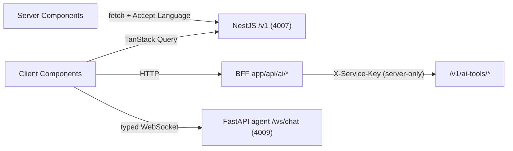

# DerLg Web Client

The customer-facing DerLg site: Cambodia travel booking with the **Vibe Booking AI concierge**, in English, Chinese, and Khmer.

> Part of the [DerLg monorepo](../README.md). Dev port **4008** via `run-all.sh` (configured default 3002).

| Dependency | Dev URL | Purpose |
|------------|---------|---------|
| Backend API (NestJS) | `http://localhost:4007` | Catalogue, auth, bookings, payments |
| AI agent (FastAPI) | `ws://localhost:4009` | Chat WebSocket `/ws/chat` |
| Admin panel | `http://localhost:4010` | Staff operations (separate app) |

---

## Contents

- [Stack](#stack)
- [Getting started](#getting-started)
- [Environment variables](#environment-variables)
- [Running the full stack](#running-the-full-stack)
- [Architecture](#architecture)
- [Directory layout](#directory-layout)
- [Features](#features)
- [Internationalisation](#internationalisation)
- [AI chat integration](#ai-chat-integration)
- [Scripts](#scripts)
- [Testing](#testing)
- [Known constraints](#known-constraints)

---

## Stack

Next.js 16 (App Router) · React 19 · TypeScript strict · Tailwind CSS v4 · TanStack Query (server state) · React hooks + localStorage (client state) · React Hook Form + Zod · next-intl (EN/ZH/KM) · Leaflet + OpenStreetMap · react-markdown + remark-gfm · Serwist (PWA) · Vitest + Testing Library · Playwright

No Google Maps key needed — maps use Leaflet with OpenStreetMap tiles.

## Getting started

```bash
cd web
npm install
cp .env.local.example .env.local   # fill in AI_SERVICE_KEY and JWT_ACCESS_SECRET
npm run dev                        # http://localhost:3002 (configured default)
npx next dev -p 4008               # dev port used by run-all.sh
```

Or from the repo root: `./run-all.sh web` (sets the port and backend/agent URLs for you).

## Environment variables

Full annotated reference: [`.env.local.example`](.env.local.example). Anything prefixed `NEXT_PUBLIC_` is inlined into the browser bundle and therefore **public**.

**Public (safe to expose)**

| Variable | Purpose |
|----------|---------|
| `NEXT_PUBLIC_API_URL` | Backend origin, no `/v1` suffix (dev: `http://localhost:4007`) |
| `NEXT_PUBLIC_AI_WS_URL` | Agent WebSocket origin (dev: `ws://localhost:4009`; `wss://` in prod) |
| `NEXT_PUBLIC_APP_URL` | This app's own origin (share links, OG metadata, sitemap) |
| `NEXT_PUBLIC_STRIPE_PUBLISHABLE_KEY` | `pk_…` only. Empty → "card payments unavailable" state. Never the `sk_` secret |
| `NEXT_PUBLIC_SUPPORT_EMAIL` / `NEXT_PUBLIC_SUPPORT_PHONE` | Shown on booking confirmations |

**Server-only (never sent to the browser)**

| Variable | Purpose |
|----------|---------|
| `AI_SERVICE_KEY` | Must exactly equal backend's and agent's. Read **only** by BFF handlers in `app/api/ai/*`. Never prefix with `NEXT_PUBLIC_` |
| `JWT_ACCESS_SECRET` | Must equal backend's. BFF verifies token signatures before trusting the subject claim; without it the BFF fails closed (guest) |
| `API_INTERNAL_URL` | Optional backend override for server-side requests (e.g. Docker-internal hostname) |
| `ALLOW_LOCAL_IMAGE_HOSTS` | `true` **in local dev only** so Next optimises MinIO-on-localhost imagery. Never in a real deployment (SSRF) |

## Running the full stack

All services must be up for end-to-end features (browse, chat, book, pay). Easiest: `./run-all.sh` from the repo root. Manually:

```bash
# 1. Infrastructure (Postgres, Redis; MinIO separately)
cd backend && docker compose up -d

# 2. Backend API on :4007
cd backend && PORT=4007 npm run start:dev

# 3. AI agent on :4009 (no --reload; unset stale keys)
cd vibe-booking && source .venv/bin/activate && \
  env -u NVIDIA_API_KEY uvicorn main:app --port 4009

# 4. This app on :4008
cd web && npx next dev -p 4008
```

**Required config in the other services** — the web origin (`http://localhost:4008`) must be allowlisted:

- `backend/.env` → `CORS_ORIGINS` includes the web origin
- `vibe-booking/.env` → `ALLOWED_WS_ORIGINS` includes it, otherwise the chat WebSocket closes with code **4403**
- `vibe-booking/.env` → `JWT_SECRET` equals backend's `JWT_ACCESS_SECRET`
- Secret alignment: `AI_SERVICE_KEY` identical across backend, web, agent

## Architecture



- **Server state** lives in TanStack Query against the typed client in `lib/api/client.ts` (envelope handling, query keys, error mapping in `lib/api/errors.ts`).
- **Client state** lives in React hooks (`hooks/use-auth.ts`, `use-theme.ts`, `use-currency.ts`, …) backed by localStorage where persistence is needed. (`zustand` is still a dependency but currently unused.)
- **Secrets never reach the browser**: the BFF route handlers under `app/api/ai/*` are the only readers of `AI_SERVICE_KEY` and `JWT_ACCESS_SECRET`.
- **Chat** uses the typed WebSocket client `lib/vibe/socket.ts` + protocol contracts `lib/vibe/protocol.ts`, wrapped by the `hooks/use-vibe-socket.ts` hook (auto-reconnect, message queue).

## Directory layout

```
app/[locale]/       Localised routes (en | zh | km): trips, hotels, guides,
                    transport, places, festivals, search, explore, chat,
                    booking(s), loyalty, saved, profile, safety, auth, …
app/api/ai/         BFF route handlers — the only place the service key is read
components/ui/      Design system primitives
components/chat/    Vibe chat UI + payloads/ block renderers (19 block types)
hooks/              React hooks — client state (auth, theme, currency), booking, vibe socket
lib/api/            Typed API client, envelope handling, query keys, errors
lib/vibe/           Typed WebSocket client, protocol, transcript, workspace
lib/auth/           Server-side token verification
lib/i18n/           Locale config + next-intl request setup
messages/           Translation catalogues: en.json, zh.json, km.json
schemas/            Zod contracts (agent payloads, forms)
tests/              Vitest unit tests (incl. i18n drift guard)
e2e/                Playwright end-to-end tests
```

## Features

- **Vibe Booking AI Chat** (`/chat`) — WebSocket chat with the RayuCode `deepseek-v4.1-flash` agent. Markdown answers, streaming reasoning, tool-status indicators, rich cards, custom trip composition, payment QR + card forms.
- **Trip Discovery** — curated packages (temples, nature, culture, adventure, food, custom) with category filtering.
- **Hotel Booking** — types (resort/boutique/hotel/guesthouse/hostel/villa), star ratings, room availability.
- **Transportation** — tuk-tuks, vans (Starex/Hiace/Alphard), buses; Normal/VIP tiers.
- **Verified Guides** — 10 languages, 8 specialties, linked trip packages.
- **Multi-Booking** — hotel + guide + transport + extras in one booking.
- **Smart Availability** — 15-minute holds with Redis TTL.
- **Payments** — Stripe card + ABA/Bakong KHQR with expiry countdown.
- **Loyalty, saved items, festivals, safety/SOS** — supporting traveller features.
- **PWA** — installable, offline caching via Serwist.

## Internationalisation

Routes live under `app/[locale]/`, so every URL carries its language: `/en/trips`, `/zh/trips`, `/km/trips`. Locale resolution: **URL prefix → `NEXT_LOCALE` cookie → `Accept-Language`**.

One locale drives four systems; `lib/i18n/config.ts` owns the mappings:

| Consumer | Shape | Example for Khmer |
|----------|-------|-------------------|
| next-intl (URL, messages) | short code | `km` |
| `<html lang>` | BCP 47 tag | `km-KH` |
| Backend | `Accept-Language` header | `km-KH,en-US;q=0.8` |
| AI agent | uppercase enum | `KH` (not `KM`) |

Catalogues: `messages/{en,zh,km}.json`. **`tests/i18n.test.ts` fails the build if catalogues drift** — add every new key to all three files.

## AI chat integration

- **Connection**: WebSocket to `{NEXT_PUBLIC_AI_WS_URL}/ws/chat`; first message is `auth` (session id, optional JWT, preferred language `EN | ZH | KH`).
- **Server events**: `conversation_started` / `conversation_resumed`, `typing_start/end`, `agent_reasoning_chunk`, `agent_stream_chunk`, `agent_tool_status`, `agent_message`, `requires_login`, `requires_payment`, `error`. Client events: `user_message`, `user_action`, `feedback`, `payment_completed`, `ping`.
- **Rendering**: `agent_message.text` is Markdown (react-markdown, HTML escaped). `content_payloads` are typed blocks routed by `components/chat/payloads/block-renderer.tsx` — 19 types including `trip_cards`, `hotel_cards`, `guide_cards`, `transport_options`, `custom_trip_card`, `booking_summary`, `booking_confirmed`, `qr_payment`, `stripe_card_form`, `payment_status`, `itinerary`, `budget_estimate`, `weather`, `comparison`, `map_view`, `image_gallery`, `trip_detail`, `hotel_detail`, `text_summary`.
- **Contracts**: Zod schemas in `schemas/`, TypeScript protocol types in `lib/vibe/protocol.ts`. Full protocol reference: [vibe-booking/AGENT.md](../vibe-booking/AGENT.md#websocket-protocol).

## Scripts

| Command | Purpose |
|---------|---------|
| `npm run dev` | Dev server (port 3002; override with `npx next dev -p 4008`) |
| `npm run build` / `npm run start` | Production build (+ Serwist PWA) / serve it |
| `npm run typecheck` | `tsc --noEmit` |
| `npm run lint` / `npm run lint:fix` | ESLint |
| `npm run format` / `npm run format:check` | Prettier |
| `npm run test` / `npm run test:watch` / `npm run test:coverage` | Vitest |
| `npm run e2e` / `npm run e2e:ui` | Playwright |
| `npm run verify` | typecheck + lint + unit tests (run before pushing) |

## Testing

```bash
npm run verify        # fast gate: types + lint + unit
npm run e2e           # Playwright (needs the full stack running)
```

The i18n drift test is part of the unit suite and blocks the build on missing keys.

## Known constraints

- **Demo payments are sandbox only.** `POST /v1/bookings/:id/confirm` marks a booking paid without a real charge, gated behind the backend's `DEMO_PAYMENTS`. Real settlement flows through Stripe webhooks / ABA alerts — see [backend/docs/payments.md](../backend/docs/payments.md).
- **AI responses are Markdown**, rendered with react-markdown (HTML escaped by default). The agent sends JSON payloads, never HTML.
- **Local image hosts**: Next 16 blocks optimising private-IP hosts; set `ALLOW_LOCAL_IMAGE_HOSTS=true` in dev only.